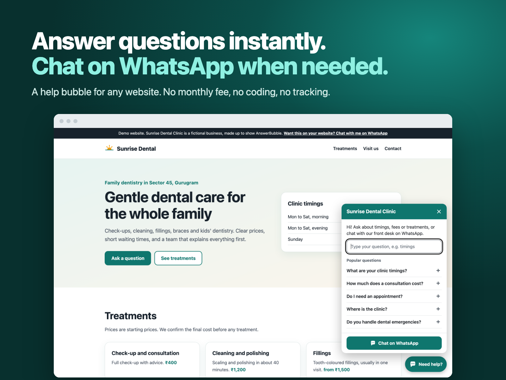

# AnswerBubble

**Instant answers and WhatsApp chat for any website.** Add a small chat bubble to your site. Visitors type a question ("fees?", "timings?", "do you deliver?") and instantly see answers from your own list of questions. If nothing fits, one tap opens WhatsApp with a ready-made message to you.

**Live demo:** https://shailesh-kala.github.io/answerbubble/demo/ · **Set it up (no coding):** https://shailesh-kala.github.io/answerbubble/configurator/



## Why use it

- **Stop answering the same questions all day.** Your timings, fees and address are answered instantly, at any hour.
- **Your customers already use WhatsApp.** When they need a person, they reach you there, with their question already typed.
- **Works on any website:** WordPress, Framer, Webflow, Shopify, Wix, Squarespace or plain HTML.
- **Free to run, forever.** No monthly fee, no signup, no server, no tracking.
- **Fast and light.** One small file (about 7 KB gzipped). It loads after your page and never shifts your layout.
- **English and Hindi built in.** Write your questions in any language. Search understands typos and Hindi text.

## 60-second quick start

**The easy way (no coding):** open `configurator/index.html`, pick your business type, fill in your WhatsApp number and answers, then click **Copy code** and paste it into your website. [Where do I paste it?](docs/INSTALL.md)

**By hand:** paste this just before `</body>`:

```html
<script>
  window.HelpWidget = {
    whatsapp: "910000000000",              // your number: country code + number, digits only
    businessName: "Sunrise Dental Clinic",
    color: "#0F766E",
    faqs: [
      { q: "What are your timings?", a: "Mon to Sat, **10 AM to 7 PM**.", keywords: ["hours", "open", "time", "समय"] },
      { q: "How much is a consultation?", a: "₹400, including a check-up.", keywords: ["fees", "price", "cost"] }
    ]
  };
</script>
<script src="https://cdn.jsdelivr.net/gh/Shailesh-Kala/answerbubble@v1.0.0/dist/help-widget-free.js" defer></script>
```

Replace `910000000000` with your own number. You can also put the contents of `help-widget-free.js` inside the first `<script>` instead of using the link ("All-in-one" code), so there is nothing to host.

**Open it from your own button:** add `data-help-open` to any button or link, e.g. `<a href="#" data-help-open>Contact us</a>`.

## Settings

| Setting | What it does | If you leave it out |
|---|---|---|
| `whatsapp` | Your WhatsApp number with country code, digits only, e.g. `910000000000`. Spaces, `+`, dashes and brackets are removed for you. | **Required.** Nothing shows without a valid number. |
| `businessName` | Shown at the top of the chat window and in the WhatsApp message. | Title says "Help". |
| `welcome` | The first line visitors see. | "Hi! Ask us anything, or chat with us on WhatsApp." |
| `color` | Your brand colour, like `#0F766E`. Black or white text is picked for you so it's easy to read. | `#0F766E` (teal) |
| `position` | `"right"` or `"left"` | `"right"` |
| `language` | Language of the buttons and labels: `"en"` (English) or `"hi"` (Hindi). | `"en"` |
| `faqs` | Your questions: `{ q: "question", a: "answer", keywords: ["other", "words"] }`. The first 5 show as "Popular questions". | Empty list: the window shows just your welcome and the WhatsApp button. |

**Answer formatting:** `**bold**`, new lines (`\n`), and links like `[Our menu](https://example.com/menu)`. Only `https:`, `http:`, `mailto:` and `tel:` links work; anything else shows as plain text. HTML is never run.

### Pro settings

| Setting | What it does |
|---|---|
| `contacts` | Several WhatsApp numbers, e.g. `[{ label: "Appointments", whatsapp: "91…" }, { label: "Billing", whatsapp: "91…" }]`. Visitors pick one before WhatsApp opens. |
| `hours` | Office hours in your time zone: `{ timezone: "Asia/Kolkata", mon: [["10:00","13:00"],["14:00","19:00"]], …, sun: [], offlineMessage: "…" }`. Outside hours a note says "We're closed now. We'll reply from Mon 10:00 AM." WhatsApp still works. Use `{when}` in `offlineMessage` for the next opening time. Times are 24-hour; a shift can't cross midnight (use `["22:00","24:00"]` and `["00:00","02:00"]` on the next day). |
| `strings` | Change any text, for any language. Keys: `launcher`, `title`, `close`, `welcome`, `label`, `placeholder`, `popular`, `matches`, `found` (use `{n}`), `found1`, `none`, `noneHint`, `chat`, `ask`, `message`, `pick`, `closed` (use `{when}`), `closedSoon`, `today`, `tomorrow`, `days` (7 short names from Sunday, separated by spaces). |
| `messageTemplate` | Your own WhatsApp message, using `{business}`, `{question}` and `{page}`. |
| `launcherLabel` | Text beside the bubble, e.g. "Need help?". |
| `hideOn` | Pages where the bubble doesn't appear: page addresses that start with these, e.g. `["/checkout", "/cart"]`. |

The free version ignores Pro settings and logs one note in the browser console.

## Free and Pro

| | Free | Pro |
|---|---|---|
| Instant answers from your questions (typos, Hindi) | ✓ | ✓ |
| WhatsApp button with the visitor's question filled in | ✓ | ✓ |
| Your colour, left or right, English or Hindi | ✓ | ✓ |
| No-code setup page | ✓ | ✓ |
| Several WhatsApp numbers (e.g. Sales, Support) | | ✓ |
| Office hours and "We're closed" note | | ✓ |
| Change any text, any language | | ✓ |
| Your own WhatsApp message | | ✓ |
| Text label beside the bubble | | ✓ |
| Hide on chosen pages (checkout, cart) | | ✓ |
| Licence | MIT | Unlimited own and client sites |

## Privacy

- No cookies, no analytics, no tracking, and no requests to any server. Search runs in the visitor's browser.
- The only time anything leaves the page is when a visitor taps the WhatsApp button and chooses to open WhatsApp.
- The WhatsApp message includes the page address (for example `https://yoursite.com/contact`) but never the part after `?` or `#`, which can hold private details.

## Accessibility

Works with a keyboard and screen readers: real buttons, a labelled dialog, focus goes to the search box when it opens, **Esc** closes it and returns focus to the bubble, and the number of answers found is announced. Tap targets are at least 44 px, text meets WCAG AA contrast, and animation is turned off for people who prefer reduced motion.

## Browsers

Current Chrome, Safari (iPhone, iPad and Mac), Firefox, Edge and Samsung Internet. Internet Explorer is not supported.

## FAQ

**Is it really free?** The free version is free forever under the MIT licence. Pro is a one-time purchase on Contra.

**Do I need a server or an account?** No. It runs entirely in your visitor's browser.

**What happens if a visitor doesn't have WhatsApp?** The link opens WhatsApp's own web page, which lets them use WhatsApp on the web or install the app.

**Will it slow my site down?** No. It's one small file, it loads after your page, and the chat window is only built when someone opens it.

**Can it clash with my website's design?** No. The widget keeps its styles separate (Shadow DOM), so your site's CSS can't break it and its CSS can't change your site.

**Can I add it to my clients' websites?** Yes, with the free version (MIT) or with Pro (unlimited client sites).

**Can someone install it for me?** Yes. Shailesh Kala offers an "I'll install it for you" service on Contra.

## For developers

Plain JavaScript with no dependencies and no build step needed to use it. The Pro download includes the source and the build script (Node 18+, no packages to install):

```bash
node build.mjs   # writes dist/ (free and Pro files) and the configurator's code files
```

`src/help-widget.js` is the single source file. Code between `/* PRO:START */` and `/* PRO:END */` is removed from the free build.

## Licence

Free version: [MIT](LICENSE). Pro version: [Pro licence](LICENSE-PRO.md).
